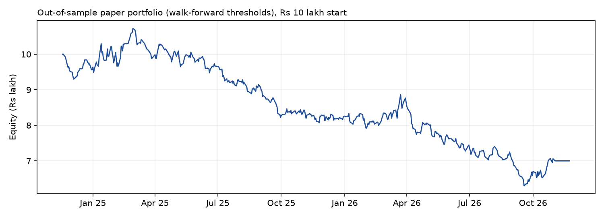
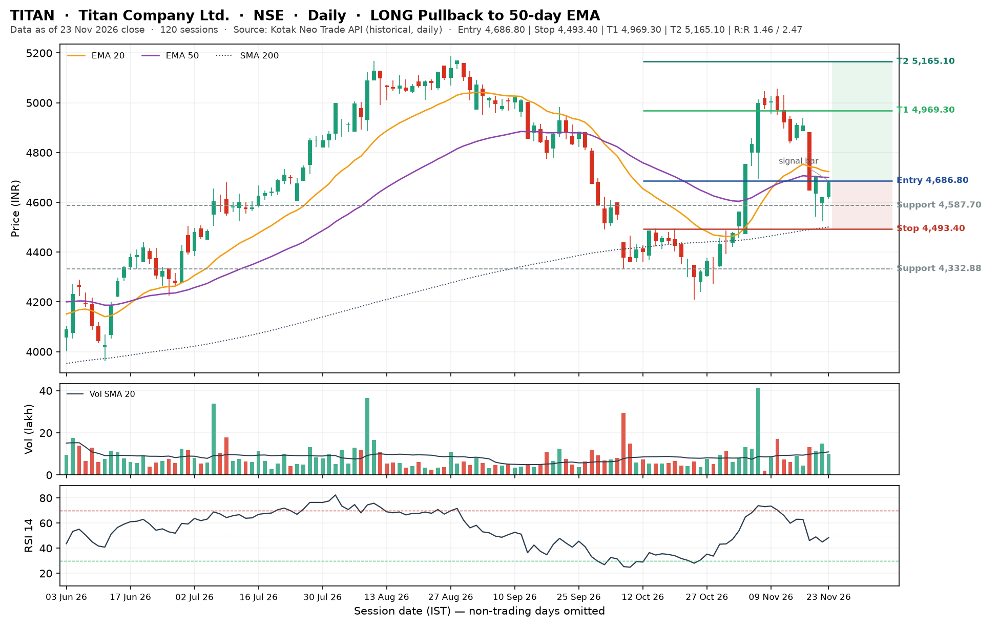
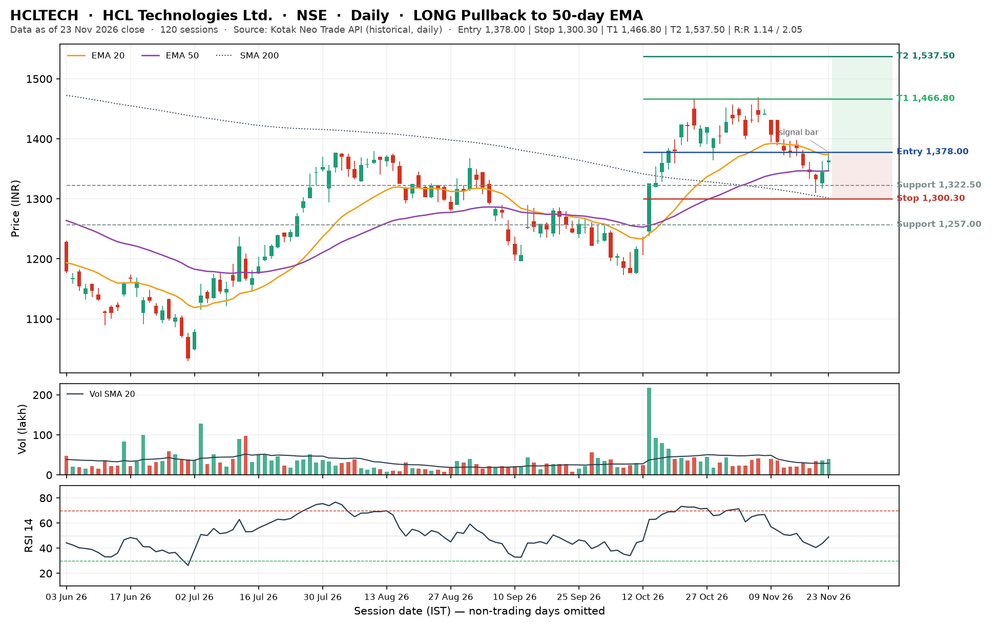

# Swing Trading Research — Indian Equity Markets

A research and **paper-trading** system for 1–3 week swing trades in NSE stocks, built on **real market data from the Kotak Neo
Trade API**. It answers the question a research desk asks every morning — *what is the market doing, which stocks have a
tradeable setup right now, where exactly would we get in, get out and be proven wrong* — and writes the answer as a dated,
professional PDF report with daily candlestick charts.

It was built for a Junior Research Associate assignment (Goodluck Capital): *at least three original swing ideas, 1–3 week horizon,
current analysis, dated daily charts, clear entry / stop / targets / risk-reward, and reasoning for why this stock and why now.*

> **Paper only.** The system cannot place, modify or cancel a real order. `EXECUTION_MODE = "PAPER"` is hard-coded, the broker
> client can only reach market-data endpoints, and a test suite proves it. Nothing here is investment advice.

---

## Contents

1. [Overview](#overview)
2. [What you need before running](#what-you-need-before-running)
3. [How to run — `run_research.py`](#how-to-run--run_researchpy)
4. [How to run — `app.py` (dashboard)](#how-to-run--apppy-dashboard)
5. [The PDF report — what it contains](#the-pdf-report--what-it-contains)
6. [Latest report (full contents)](#latest-report-full-contents)
7. [Method](#method)
8. [Paper execution and safety](#paper-execution-and-safety)
9. [Backtesting and what it found](#backtesting-and-what-it-found)
10. [Project structure](#project-structure)
11. [Tests](#tests)
12. [Limitations](#limitations)

---

## Overview

```
Kotak Neo API ──► daily OHLCV (249 stocks + 23 indices, ~4 years) ──► SQLite
                                         │
       ┌─────────────────────────────────┼──────────────────────────────────┐
       ▼                                 ▼                                  ▼
 Market regime                   Stock screener                        Backtest
 NIFTY / BANK / MIDCAP trend,    liquidity → 9 price-action setups    same rules replayed day by day,
 breadth, INDIA VIX              → structural entry / stop / targets  walk-forward out-of-sample,
 → Strong Bullish … Strong       → 100-point explainable score        Indian costs + slippage
   Bearish                       → event / sector / correlation checks
       └─────────────────────────────────┼──────────────────────────────────┘
                                         ▼
               Top 3 ideas (or fewer — a shortfall is reported, never filled)
                                         ▼
      PDF report · candlestick charts · CSV · SQLite · Streamlit dashboard · paper orders
```

**What makes it different from a generic stock screener**

* **Real data, verified.** Every price comes from Kotak Neo's own historical and quotes APIs; nothing is synthetic, and a stock
  whose data fails validation is excluded rather than patched.
* **Regime first.** The market is classified before any stock is looked at; longs are not taken in a Strong Bearish market and
  shorts are not taken in a Strong Bullish one.
* **Levels come from the chart, not percentages.** Stops sit beyond the price that proves the idea wrong; targets are real
  support/resistance levels. Targets are never stretched to make a reward:risk number pass.
* **Every score point has a reason** ("+4 EMA20 above EMA50", "0/7 signal-day volume only 0.9× average").
* **Honest validation.** The exact same code is backtested with walk-forward out-of-sample testing, realistic Indian costs, gap-aware
  fills and no look-ahead. The result is reported as found — currently: **no historical edge** (see [Backtesting](#backtesting-and-what-it-found)).
* **Short selling handled correctly.** Overnight shorts are not possible in NSE cash equities, so short ideas are only treated as
  executable through the stock's NSE futures contract, in whole lots, within the risk budget.

---

## What you need before running

### 1. Software

| Requirement | Notes |
|---|---|
| Python **3.11+** | developed on 3.12 |
| `uv` (recommended) or `pip` | |
| TA-Lib | `pip install ta-lib` ships binary wheels for Linux/macOS/Windows (0.6+); no C library build needed |
| Internet access to `*.kotaksecurities.com` | the API forces IPv4 (Kotak's whitelist is IPv4) |

```bash
git clone https://github.com/pranay123-stack/swing-trading-research-nse.git
cd swing-trading-research-nse
uv venv --python 3.12 .venv
uv pip install --python .venv/bin/python -r requirements.txt
#  or:  python -m venv .venv && .venv/bin/pip install -r requirements.txt
```

### 2. A Kotak Neo account with Trade API access

1. Open the **Kotak Neo** app → **Trade API** → create an application → copy the **API token** shown on the dashboard.
2. Find your **base URL**: it is the `baseUrl` field returned by Kotak's `/tradeApiValidate` login step
   (for example `https://e22.kotaksecurities.com`). If you don't know it, leave it empty and fill in the login fields below — the
   client will log in once to discover it.

Market-data endpoints (instrument master, quotes, historical candles) authenticate with **the API token alone** — verified live.
No order permissions are needed and none are used.

### 3. The `.env` file

```bash
cp .env.example .env
```

| Variable | Required | What it is |
|---|---|---|
| `KOTAK_ACCESS_TOKEN` | **yes** | API token from the NEO Trade API dashboard |
| `KOTAK_BASE_URL` | recommended | e.g. `https://e22.kotaksecurities.com`; if set, no login is needed |
| `KOTAK_MOBILE`, `KOTAK_UCC`, `KOTAK_MPIN` | only if `KOTAK_BASE_URL` is empty | login details used once to discover the base URL |
| `KOTAK_TOTP_SECRET` | only if `KOTAK_BASE_URL` is empty | base32 TOTP secret from the Kotak authenticator registration |

`.env` is git-ignored; credentials are never written anywhere and are redacted from error messages. Setting any live-trading
variable (`KOTAK_LIVE_TRADING_ENABLED`, `LIVE_TRADING`, `EXECUTION_MODE`, …) makes the program refuse to start.

> The original spec listed `CONSUMER_KEY / CONSUMER_SECRET / PASSWORD` — those belong to Kotak's old v1 SDK. The current v2 API uses
> the API token + mobile/UCC/TOTP/MPIN flow; `.env.example` explains the mapping.

### 4. Optional settings — `config.py`

All tunables live in one file: universe filters (min price ₹50, median traded value ≥ ₹40 cr, ≥ 220 sessions of history),
strategy rules (score ≥ 60, R:R ≥ 1.0 to T1 and ≥ 2.0 to T2, stop 1–3.5 ATR), paper capital (₹10 lakh, 1% risk per idea, ≤ 25% per
position), and the cost model (Kotak Neo Trade Free brokerage, STT, exchange fees, stamp duty, GST, DP charge, slippage).

---

## How to run — `run_research.py`

`run_research.py` is the **research engine**: one command that produces the report.

```bash
.venv/bin/python run_research.py
```

What it does, in order (each step prints a line):

| Step | What happens |
|---|---|
| `[1]` | Connects to Kotak Neo **market data** (read-only). |
| `[2]` | Downloads today's instrument master and brings daily candles up to date for 249 stocks (NIFTY 100 + NIFTY MIDCAP 150) and 23 indices (NIFTY 50, BANK, MIDCAP 100, sector indices, INDIA VIX). First run downloads ~4 years (≈35 min at Kotak's ~1 request/s limit); later runs fetch only the last few weeks (≈5 min). |
| `[3]` | Validates data: OHLC consistency, duplicates, missing sessions vs the NIFTY calendar, staleness. Before 15:45 IST today's still-forming bar is ignored. |
| `[4]` | Classifies the market regime. |
| `[5]` | Scans every liquid stock for setups and scores them. |
| `[6]` | Runs the walk-forward backtest (≈10 min). |
| `[7]` | Selects up to 3 ideas: event risk, executability, one per sector, correlation ≤ 0.75. |
| `[8]` | Draws a daily candlestick chart for each idea. |
| `[9]` | Writes the PDF, CSV, JSON, saves everything to SQLite and refreshes the report section of this README. |

Options:

| Flag | Use |
|---|---|
| `--no-sync` | don't download; use the candles already in the database |
| `--skip-backtest` | reuse the last backtest (`reports/backtest_summary.json`) |
| `--no-yahoo` | skip the Yahoo Finance earnings/dividend calendar |
| `--paper` | also place the selected ideas as **paper** orders (simulation) |
| `--n 5` | ask for a different number of ideas |

Outputs:

| File | Contents |
|---|---|
| `reports/Swing_Trading_Research_<date>.pdf` | the research report |
| `reports/trade_ideas_<date>.csv` | ideas with all levels, sizing, scores |
| `charts/<SYMBOL>_<SIDE>_<date>.png` | daily candlestick charts (150 dpi) |
| `reports/research_context.json` | everything the report is built from |
| `reports/backtest_*.csv / .json / .png` | signals, trades, equity curves, summary |
| `database/swing_research.sqlite` | candles, API log, runs, screen results, ideas, paper orders/fills/positions |
| `logs/research.log` | run log |

Columns of the backtest CSVs:

| File | Columns |
|---|---|
| `backtest_signals.csv` | `d` signal date · `symbol` · `side` · `setup` · `score` (0–100) · `regime` · `regime_ok` (setup allowed in that regime) · `entry` · `stop` · `t1` · `t2` · `atr` · `rr_t2` · `sector` · `fno` (has stock futures) |
| `backtest_isolated_trades.csv`, `backtest_portfolio_trades.csv` | `signal_d` · `symbol` · `side` · `setup` · `score` · `regime` · `state` (CLOSED / OPEN / EXPIRED / CANCELLED) · `entry_d` · `exit_d` · `exit_reason` (STOP, STOP_GAP, T2, T2_GAP, BREAKEVEN, BREAKEVEN_GAP, TIME) · `entry_price` · `qty` · `gross` (₹ before costs) · `costs` (₹) · `net` (₹ after costs) · `risk` (₹ at the initial stop) · `r` (net ÷ risk) · `bars_held` (sessions) · `notional` (₹) |
| `backtest_equity_oos.csv`, `backtest_equity_fixed60.csv` | `date` · `equity_inr` (daily mark-to-market paper equity, ₹10 lakh start) · `daily_return_pct` · `drawdown_pct` (from the running peak) |

`_oos` = walk-forward out-of-sample portfolio (per-fold score thresholds); `_fixed60` = whole period with the default threshold 60.

**Best time to run:** after 15:45 IST on a trading day, so the day's completed session is included.

---

## How to run — `app.py` (dashboard)

`app.py` is a **Streamlit dashboard** for browsing what `run_research.py` produced. It downloads nothing and has no broker access.

```bash
.venv/bin/streamlit run app.py        # opens http://localhost:8501
```

| Tab | What you see |
|---|---|
| **A. Market overview** | regime and its components, breadth, VIX, index quotes, sector performance chart, NIFTY 50 chart |
| **B. Screener** | every setup found, its score and pass/reject reason; filters by side, score, passing only |
| **C. Trade ideas** | the selected ideas: levels, chart, why this stock / why now / catalyst / confirmation / invalidation, score card |
| **D. Paper portfolio** | place the current ideas as **paper** orders, re-simulate fills from the latest candles, open/closed positions, P&L, fill history, backtest results |
| **E. Reports** | regenerate the PDF; download PDF, CSV and chart PNGs |
| **F. Data health** | last successful API call, candle coverage and freshness, missing candles / validation per symbol, API error log |

Run `run_research.py` first — the dashboard shows "No research run yet" until it has.

---

## The PDF report — what it contains

Title: **"Swing Trading Research — Indian Equity Markets"** — A4, ~11 pages, every page footed "research and paper simulation
only, not investment advice".

| Section | Contents |
|---|---|
| **1. Executive Summary** | regime, breadth, VIX, live NIFTY quote; scan funnel (stocks → setups → passing → selected); the historical-evidence verdict; summary table of ideas (CMP, entry, stop, T1, T2, R:R, score); one-line thesis per idea; shortfall note if fewer than 3 |
| **2. Research Methodology** | data sources, universe filters, regime-first approach, the setups, level construction, scoring weights, selection rules, sizing, cost model; **historical validation**: isolated / walk-forward / portfolio metrics, before-vs-after-cost table, per-setup out-of-sample table, equity curve |
| **3. Current Market Regime** | each regime component with its points and the observation behind it; index quotes with timestamps |
| **4. Sector Analysis** | all NSE sector indices: 5/20/60-day returns, relative strength vs NIFTY, above EMA50, RSI, rotation quadrant |
| **5. Trade Ideas** | one section per idea, each with its dated daily chart |
| **6. Technical Thesis** | per idea: **WHY THIS STOCK? · WHY NOW? · WHAT IS THE CATALYST? · WHAT CONFIRMS THE TRADE? · WHAT INVALIDATES THE TRADE? · WHAT IS THE MAXIMUM RISK? · WHAT IS THE EXPECTED HOLDING PERIOD?** |
| **7–8. Entry, Stop-loss, Targets, Risk/Reward** | CMP (Kotak quote + time), entry order, stop and its structural basis, T1/T2 and the level each is based on, risk/reward per share, paper position size, capital at risk, round-trip cost; futures execution note for shorts |
| **9. Invalidation Conditions** | price stop, time stop, regime change |
| **10. Upcoming Event Risk** | events found in the holding window with source and retrieval time |
| **Score card** | 7 components with supporting and opposing evidence, total /100, plus the backtest record of that setup type |
| **11. Daily Candlestick Charts** | index of chart files |
| **12. Research Limitations** | what the analysis does not cover and where it can be wrong |
| **13. Data Sources and As-of Timestamp** | every source with its as-of time; all times IST |

Each chart shows: symbol, company, NSE, daily timeframe, data as-of date, 120 sessions of candles with a dated axis, EMA 20, EMA 50,
SMA 200, volume with its 20-day average, RSI 14, the nearest major support/resistance, and the entry, stop, T1 and T2 lines with
shaded risk and reward zones.

---

## Latest report (full contents)

Generated automatically from the same data as the PDF at the end of every `run_research.py` run.

<!-- REPORT:START -->
**Report:** [`reports/Swing_Trading_Research_2026-11-23.pdf`](reports/Swing_Trading_Research_2026-11-23.pdf)
  
**Data as of:** 2026-11-23 NSE close · **generated:** 2026-11-25T11:39:47+05:30 IST · run `20261125-113940-ebf2`

#### 1. Executive summary

* Market regime: **Strong Bullish** (composite +0.67 on −1…+1). Breadth: 59% of the universe above its 50-day EMA, 52% above its 200-day SMA. INDIA VIX 17.70.
* Scan: 249 liquid stocks → 67 setups → 2 passed every rule → **2 idea(s)** after event, executability, sector and correlation checks. **Shortfall of 1** reported, not filled.
* Historical evidence: walk-forward out-of-sample expectancy **-0.18 R/trade** (t = -6.7), 1 of 8 test windows positive — the setup family shows **no edge**; ideas are presented as individually argued theses with defined risk.

| # | Stock | Side / setup | CMP | Entry | Stop | T1 | T2 | R:R T1 / T2 | Score |
|---|---|---|---|---|---|---|---|---|---|
| 1 | **TITAN** (Titan Company Ltd.) | LONG · Pullback to 50-day EMA | 4,642.30 | 4,686.80 | 4,493.40 | 4,969.30 | 5,165.10 | 1.46 / 2.47 | 66 (Moderate) |
| 2 | **HCLTECH** (HCL Technologies Ltd.) | LONG · Pullback to 50-day EMA | 1,377.60 | 1,378.00 | 1,300.30 | 1,466.80 | 1,537.50 | 1.14 / 2.05 | 65 (Moderate) |

#### 2. Research methodology

Data sources, universe filters, regime-first approach, the nine price-action setups, structural entry/stop/target rules, the 100-point score, selection rules, sizing and Indian cost model — summarised in [Method](#method) below.

Historical validation (2023-11-15 → 2026-10-27, 731 sessions, 5230 setups, 84% of stop entries triggered):

| Measure | All signals (isolated) | Walk-forward OOS | OOS paper portfolio |
|---|---|---|---|
| Trades | 3494 | 2017 | 242 |
| Win rate | 43.5% | 41.3% | 43.0% |
| Profit factor | 0.79 | 0.73 | 0.75 |
| Expectancy (R, net) | -0.134 (t -6.6) | -0.178 (t -6.7) | -0.152 |
| Avg holding (sessions) | 8.3 | 8.1 | 8.2 |
| Return / max DD / Sharpe | - | - | -30.0% / -41.3% / -0.99 |

| Group | Trades | Mean R before costs | Cost drag (R) | Mean R after costs |
|---|---|---|---|---|
| All | 3494 | -0.006 | 0.128 | -0.134 |
| LONG | 2395 | -0.014 | 0.179 | -0.193 |
| SHORT | 1099 | +0.011 | 0.017 | -0.005 |

| Setup (out-of-sample) | Trades | Win % | Profit factor | Expectancy R | t | Median hold |
|---|---|---|---|---|---|---|
| Bearish trend continuation (EMA rejection) | 445 | 48.1 | 1.03 | 0.036 | 0.6 | 7 |
| Support bounce | 418 | 38.3 | 0.54 | -0.331 | -5.9 | 8 |
| Resistance rejection | 402 | 43.0 | 0.86 | -0.055 | -0.9 | 7 |
| Pullback to 20-day EMA | 231 | 35.9 | 0.56 | -0.336 | -4.3 | 8 |
| Pullback to 50-day EMA | 221 | 42.5 | 0.70 | -0.223 | -2.9 | 9 |
| Breakout | 210 | 38.6 | 0.60 | -0.281 | -3.5 | 9 |
| Breakdown | 81 | 29.6 | 0.55 | -0.336 | -2.5 | 6 |
| Failed breakout | 9 | 44.4 | 0.64 | -0.151 | -0.4 | 7 |



#### 3. Current market regime

| Component | Points | Observation |
|---|---|---|
| NIFTY 50 short-term trend | +2 | close 25,350 > EMA20 24,699; EMA20 > EMA50 24,049 |
| NIFTY 50 primary trend | +2 | close above SMA200 23,996; EMA50 20-day slope +3.61% |
| NIFTY BANK trend | +2 | close above EMA50; EMA20 > EMA50 |
| NIFTY MIDCAP 100 trend | +2 | close above EMA50; EMA20 > EMA50 |
| Breadth (EMA50) | +1 | 59% of universe stocks close above their 50-day EMA |
| Breadth (SMA200) | +0 | 52% of universe stocks close above their 200-day SMA |
| INDIA VIX | -1 | VIX 17.70, +12.9% over 5 sessions |

| Index | Last | Change | Quote time (IST) |
|---|---|---|---|
| Nifty 50 | 25,917.85 | +2.24% | 2026-11-25T11:39:49+05:30 |
| Nifty Bank | 63,964.55 | +2.20% | 2026-11-25T11:39:49+05:30 |
| INDIA VIX | 17.75 | +0.28% | 2026-11-25T11:39:45+05:30 |

#### 4. Sector analysis

| Index | 5d % | 20d % | 60d % | vs NIFTY 20d | vs NIFTY 60d | > EMA50 | Quadrant |
|---|---|---|---|---|---|---|---|
| Nifty Realty | 3.6 | 19.3 | 3.5 | 7.1 | -1.2 | yes | Improving |
| Nifty PSU Bank | 2.7 | 18.1 | 10.3 | 6.0 | 5.3 | yes | Leading |
| Nifty Fin Service | 0.5 | 15.1 | 6.7 | 3.3 | 1.9 | yes | Leading |
| Nifty Bank | 1.6 | 15.1 | 8.3 | 3.3 | 3.4 | yes | Leading |
| NIFTY CONSR DURBL | 0.3 | 14.4 | -4.3 | 2.7 | -8.6 | yes | Improving |
| Nifty Pvt Bank | 1.4 | 14.3 | 10.6 | 2.6 | 5.6 | yes | Leading |
| Nifty Auto | 3.3 | 14.1 | -1.8 | 2.4 | -6.2 | yes | Improving |
| Nifty Consumption | 1.4 | 13.5 | 2.5 | 1.9 | -2.2 | yes | Improving |
| Nifty FMCG | 1.3 | 12.9 | 2.2 | 1.3 | -2.4 | yes | Improving |
| Nifty Media | -0.8 | 12.3 | 8.6 | 0.8 | 3.7 | yes | Leading |
| Nifty 50 | 0.2 | 11.4 | 4.7 | 0.0 | 0.0 | yes | Leading |
| NIFTY HEALTHCARE | 1.5 | 11.3 | 5.1 | -0.1 | 0.4 | yes | Weakening |
| Nifty Infra | -0.1 | 10.0 | 2.6 | -1.2 | -2.0 | yes | Lagging |
| Nifty 500 | -0.0 | 9.9 | 0.8 | -1.4 | -3.7 | yes | Improving |
| Nifty Pharma | 0.7 | 9.8 | 6.2 | -1.5 | 1.5 | yes | Weakening |
| NIFTY MIDCAP 100 | -0.3 | 8.7 | -4.2 | -2.4 | -8.5 | yes | Improving |
| Nifty Serv Sector | -0.2 | 8.4 | 5.9 | -2.7 | 1.1 | yes | Weakening |
| NIFTY OIL AND GAS | -0.5 | 7.5 | 1.4 | -3.5 | -3.2 | yes | Lagging |
| Nifty Commodities | -2.1 | 5.1 | -4.9 | -5.6 | -9.2 | no | Lagging |
| Nifty Energy | -1.7 | 4.7 | -3.8 | -6.1 | -8.1 | no | Lagging |
| Nifty Metal | -5.1 | 0.7 | -12.7 | -9.6 | -16.7 | no | Lagging |
| Nifty IT | -0.3 | -1.3 | 5.1 | -11.4 | 0.3 | yes | Weakening |

#### 5–11. Trade ideas

##### Idea 1: TITAN — LONG (Pullback to 50-day EMA), score 66/100

Titan Company Ltd. · NSE · Consumer Durables · signal session 2026-11-23 · executable as eq delivery



**Why this stock?**
- Titan Company Ltd. (Consumer Durables; member of NIFTY 50, NIFTY 100). Median 20-day traded value Rs 436 crore: liquid enough to enter and exit a swing position without moving the price.
- Relative strength: +8.3% over 20 sessions vs NIFTY 50 +11.1% (-2.8% excess); -12.4% excess over 60 sessions; -5.3% vs its sector index (NIFTY CONSR DURBL).
- Sector backdrop: NIFTY CONSR DURBL is +14.4% over 20 sessions (+2.7% vs NIFTY), rotation quadrant 'Improving'.

**Why now?**
- pulled back 4.4 ATR from the 5,056.60 swing high into the rising 50-day EMA (low 4,524.00)
- RSI cooled to 48; today's bar reversed up (strong_bull_close)
- Trend: close 4,680.00 vs EMA20 4,723.48 / EMA50 4,700.20 / SMA200 4,500.74; ADX 31; RSI 48.
- Market regime Strong Bullish (+0.67): supports a long position.

**What is the catalyst?**
- Technical catalyst: the pullback to 50-day ema on 2026-11-23 (volume 0.9x average).
- Sector rotation: NIFTY CONSR DURBL leading the index over 20 sessions.
- No company-specific news catalyst is claimed; scheduled events found are listed under event risk.

**What confirms the trade?**
- A buy-stop trigger at 4,686.80 (above the signal bar's high); the order is valid for 3 sessions and is cancelled if 4,493.40 trades first.
- Follow-through volume at or above the 20-day average (10.9 lakh shares) on the trigger day.
- Holding above EMA50 4,700.20 on closing basis.

**What invalidates the trade?**
- Stop-loss 4,493.40: a break of the pullback low 4,524.00 means the trend's buyers did not defend the EMA (invalidation 4,524.00 minus a 0.25 ATR buffer).
- Time stop: exit if neither target is reached within 15 sessions.
- Regime change: a NIFTY 50 close below its 50-day EMA (24,049) would remove the market tailwind.

**What is the maximum risk?** Rs 193.40 per share (4.13% of entry, 1.6 ATR). Position 51 shares -> Rs 9,863 at the stop = 0.99% of Rs 10 lakh capital, plus ~0.70% round-trip costs. A gap through the stop can exceed this.

**Expected holding period:** 5-15 sessions (1-3 weeks); time stop at 15; in the backtest this setup's trades lasted a median 9 sessions

| Item | Level | Basis |
|---|---|---|
| Current market price | 4,642.30 | Kotak Neo quotes API, 2026-11-25T11:39:49+05:30 |
| Entry (stop order) | 4,686.80 | beyond the 2026-11-23 bar, valid 3 sessions |
| Stop-loss | 4,493.40 | invalidation 4,524.00 ± 0.25 ATR; 1.58 ATR |
| Target 1 (book 50%) | 4,969.30 | resistance 4,981.50 (2 touches, last 2026-09-03) |
| Target 2 | 5,165.10 | resistance 5,177.35 (2 touches, last 2026-08-27) |
| Risk / reward per share | 193.40 / 282.50, 478.30 | R:R 1.46 / 2.47 |
| Paper position | 51 | cash delivery (CNC); notional Rs 239,027, risk Rs 9,863 (0.99% of capital) |

**Event risk:** no scheduled event found in 2026-11-23..2026-12-17 (Kotak scrip master, Yahoo Finance calendar)

| Score component | Points | Supporting | Against |
|---|---|---|---|
| Trend structure | 14/20 | +4 EMA20 above EMA50<br>+4 EMA50 above SMA200 (primary trend aligned)<br>+3 price above SMA200<br>+3 EMA50 sloping up (+1.1% / 20d) | 0/3 close on the wrong side of EMA20<br>0/3 ADX 31 / DI not confirming a directional trend |
| Momentum | 10/15 | +6 RSI 48 in the reset zone for this setup<br>+4 20-day ROC +8.3% (trend intact through the pullback) | 0/5 MACD histogram moving against the trade (-15.61 -> -20.26) |
| Volume confirmation | 8/15 | +4 OBV above its 20-day EMA (accumulation)<br>+4 up/down volume ratio 2.11 over 20 sessions | 0/7 signal-day volume only 0.9x average (want >= 1.1) |
| Relative strength | 3/15 | +3 sector outperforming NIFTY (+2.7%, 20d) | 0/5 -2.8% vs NIFTY 50 over 20 sessions<br>0/4 -12.4% vs NIFTY 50 over 60 sessions<br>0/3 -5.3% vs its sector index (20d) |
| Price action | 15/15 | +4 closed in the upper part of the day's range (0.91)<br>+4 confirming candle: strong_bull_close<br>+4 tight structure: stop 1.6 ATR from entry<br>+3 entry -0.3 ATR from EMA20 (not extended) | - |
| Risk/reward | 6/10 | 6/10 reward:risk 1.46 to T1, 2.47 to T2 | - |
| Market regime alignment | 10/10 | 10/10 long idea in a Strong Bullish market | - |

##### Idea 2: HCLTECH — LONG (Pullback to 50-day EMA), score 65/100

HCL Technologies Ltd. · NSE · Information Technology · signal session 2026-11-23 · executable as eq delivery



**Why this stock?**
- HCL Technologies Ltd. (Information Technology; member of NIFTY 50, NIFTY 100). Median 20-day traded value Rs 416 crore: liquid enough to enter and exit a swing position without moving the price.
- Relative strength: -3.7% over 20 sessions vs NIFTY 50 +9.9% (-13.6% excess); +0.3% excess over 60 sessions; -2.4% vs its sector index (Nifty IT).
- Sector backdrop: Nifty IT is -1.3% over 20 sessions (-11.4% vs NIFTY), rotation quadrant 'Weakening'.

**Why now?**
- pulled back 4.4 ATR from the 1,469.00 swing high into the rising 50-day EMA (low 1,309.40)
- RSI cooled to 49; today's bar reversed up (close above prior high)
- Trend: close 1,364.30 vs EMA20 1,373.51 / EMA50 1,346.82 / SMA200 1,301.69; ADX 21; RSI 49.
- Market regime Strong Bullish (+0.67): supports a long position.

**What is the catalyst?**
- Technical catalyst: the pullback to 50-day ema on 2026-11-23 (volume 1.4x average).
- No company-specific news catalyst is claimed; scheduled events found are listed under event risk.

**What confirms the trade?**
- A buy-stop trigger at 1,378.00 (above the signal bar's high); the order is valid for 3 sessions and is cancelled if 1,300.30 trades first.
- Follow-through volume at or above the 20-day average (29.2 lakh shares) on the trigger day.
- Holding above EMA50 1,346.82 on closing basis.

**What invalidates the trade?**
- Stop-loss 1,300.30: a break of the pullback low 1,309.40 means the trend's buyers did not defend the EMA (invalidation 1,309.40 minus a 0.25 ATR buffer).
- Time stop: exit if neither target is reached within 15 sessions.
- Regime change: a NIFTY 50 close below its 50-day EMA (24,049) would remove the market tailwind.

**What is the maximum risk?** Rs 77.70 per share (5.64% of entry, 2.1 ATR). Position 128 shares -> Rs 9,946 at the stop = 0.99% of Rs 10 lakh capital, plus ~0.71% round-trip costs. A gap through the stop can exceed this.

**Expected holding period:** 5-15 sessions (1-3 weeks); time stop at 15; in the backtest this setup's trades lasted a median 9 sessions

| Item | Level | Basis |
|---|---|---|
| Current market price | 1,377.60 | Kotak Neo quotes API, 2026-11-25T11:39:49+05:30 |
| Entry (stop order) | 1,378.00 | beyond the 2026-11-23 bar, valid 3 sessions |
| Stop-loss | 1,300.30 | invalidation 1,309.40 ± 0.25 ATR; 2.14 ATR |
| Target 1 (book 50%) | 1,466.80 | resistance 1,470.47 (3 touches, last 2026-11-06) |
| Target 2 | 1,537.50 | volatility projection (4.5 x ATR, ~15-session reach) |
| Risk / reward per share | 77.70 / 88.80, 159.50 | R:R 1.14 / 2.05 |
| Paper position | 128 | cash delivery (CNC); notional Rs 176,384, risk Rs 9,946 (0.99% of capital) |

**Event risk:** no scheduled event found in 2026-11-23..2026-12-17 (Kotak scrip master, Yahoo Finance calendar)

| Score component | Points | Supporting | Against |
|---|---|---|---|
| Trend structure | 14/20 | +4 EMA20 above EMA50<br>+4 EMA50 above SMA200 (primary trend aligned)<br>+3 price above SMA200<br>+3 EMA50 sloping up (+4.1% / 20d) | 0/3 close on the wrong side of EMA20<br>0/3 ADX 21 / DI not confirming a directional trend |
| Momentum | 15/15 | +6 RSI 49 in the reset zone for this setup<br>+5 MACD histogram turning up (-14.48 -> -12.22)<br>+4 20-day ROC -3.7% (trend intact through the pullback) | - |
| Volume confirmation | 15/15 | +7 signal-day volume 1.4x the 20-day average<br>+4 OBV above its 20-day EMA (accumulation)<br>+4 up/down volume ratio 1.45 over 20 sessions | - |
| Relative strength | 4/15 | +4 +0.3% vs NIFTY 50 over 60 sessions | 0/5 -13.6% vs NIFTY 50 over 20 sessions<br>0/3 -2.4% vs its sector index (20d)<br>0/3 sector -11.4% vs NIFTY (20d) works against the trade |
| Price action | 3/15 | +3 entry 0.1 ATR from EMA20 (not extended) | 0/4 weak close location 0.55<br>0/4 no confirming candlestick pattern<br>0/4 loose structure: stop 2.1 ATR from entry |
| Risk/reward | 4/10 | 6/10 reward:risk 1.14 to T1, 2.05 to T2 | -2 T2 is a volatility projection, not a chart level |
| Market regime alignment | 10/10 | 10/10 long idea in a Strong Bullish market | - |

#### 12. Research limitations

Technical analysis only (no valuation/news catalyst claimed); Yahoo earnings dates can be estimates; survivorship bias in the backtest universe; shorts backtested on cash prices as a futures proxy; daily bars hide the intraday path (worst case assumed); stops are not guaranteed through gaps; scores rank evidence, they are not probabilities.

#### 13. Data sources and as-of timestamp

Kotak Neo historical + quotes API (prices, 2026-11-23 close), Kotak scrip master (2026-11-25), NSE Indices constituent files, Yahoo Finance calendar, Kotak Neo pricing page / NSE charges / Budget 2026 STT for costs. All timestamps IST.
<!-- REPORT:END -->

---

## Method

**Data.** Kotak Neo `market-data/1.0/historical/details` (interval D) for all prices, requested in ≤179-day windows (the API rejects
>180 days and from-dates older than 5 years; ~1 request/s sustained, verified live). Indices are requested by exact name
(`Nifty 50`, `INDIA VIX`). Kotak's daily scrip master gives instrument tokens, tick size, circuit band, record dates and stock-futures
contracts. Index membership and industry come from NSE Indices' published constituent files.

**Universe.** NIFTY 50 + NEXT 50 + MIDCAP 150 constituents → filtered to price ≥ ₹50, median 20-day traded value ≥ ₹40 crore,
median volume ≥ 1 lakh shares, ≥ 220 sessions of history, no zero-volume session in 60 days.

**Market regime.** NIFTY 50 short-term and primary trend (EMA20/EMA50/SMA200, EMA50 slope), NIFTY BANK and NIFTY MIDCAP 100 trend,
% of universe above EMA50 and SMA200, INDIA VIX level and 5-day change → composite −1…+1 → Strong Bullish / Bullish / Sideways /
Bearish / Strong Bearish. Fixed thresholds, not fitted.

**Indicators (daily).** EMA 9/20/50, SMA 100/200, ADX/±DI, RSI 14, MACD, Stochastic RSI, ROC 5/10/20, ATR 14, Bollinger Bands,
20-day historical volatility, volume SMA 20, relative volume, OBV; swing pivots, support/resistance clusters, bases and flags,
candlestick patterns, gaps; relative strength vs NIFTY 50 and vs the stock's sector index.

**Setups.**

| Long | Short |
|---|---|
| Breakout from a base on ≥1.5× volume | Breakdown from a base on ≥1.5× volume |
| Trend continuation out of a tight flag | Bearish continuation out of a bear flag |
| Pullback to a rising 20/50-day EMA with a reversal bar | Rally rejected at a falling 20/50-day EMA |
| Bounce from multi-touch support | Rejection at multi-touch resistance |
| | Failed breakout (trapped buyers) |

**Levels.** Entry = stop order just beyond the signal bar (buy-stop above its high / sell-stop below its low), valid 3 sessions — the
market must confirm. Stop = structural invalidation level ± 0.25 ATR; widened to 1 ATR if tighter, setup rejected if more than 3.5 ATR.
T1 = first *major* level in the trade's direction (≥2 touches, a swing dominating ≥10 sessions each side, or the 52-week extreme);
T2 = the next one. A measured move or volatility projection is used only where no level exists, and is labelled. Requires R:R ≥ 1.0
to T1 and ≥ 2.0 to T2.

**Score (100).** Trend structure 20 · momentum 15 · volume 15 · relative strength 15 · price action 15 · reward:risk 10 · regime 10.

**Selection.** Score ≥ 60; one idea per sector; 60-day return correlation ≤ 0.75 between ideas; no earnings / results / board meeting
inside the holding window; shorts only if executable through NSE stock futures within the 1% risk budget.

**Sizing and costs.** ₹10 lakh paper capital, 1% risked at the stop, ≤ 25% notional per cash position (futures ≤ 1× capital, whole
lots). Costs per fill: Kotak Neo Trade Free brokerage (0.20% delivery, ₹10 per F&O order), STT 0.1% each side on delivery and 0.05% on
futures sales (Budget 2026), NSE transaction charges, SEBI fee, stamp duty, 18% GST, DP charge, plus 5 bps slippage.

---

## Paper execution and safety

* `config.py`: `EXECUTION_MODE = "PAPER"` is a constant; `assert_paper_mode()` runs at every entry point and **fails closed** if it is
  changed or a live-trading environment variable is present.
* `data/kotak_client.py` has no order, position or funds methods and refuses — before any network I/O — any path outside an
  allowlist of market-data endpoints.
* `execution/` and `backtesting/` import no network library and no broker client.
* Paper orders are immutable; fills and positions are **derived** by replaying them over stored candles, so re-running never
  duplicates a fill; duplicate orders are refused; the database only accepts `mode = 'PAPER'`.
* `tests/test_no_live_orders.py` proves this statically (AST scan of every source file), at the endpoint level, and at runtime (all
  network sends trapped during a full paper flow). The static checks were mutation-tested.

**Fill model** (shared by the paper broker and the backtest): fills only from the session after the signal; a gap through the
trigger fills at the open; an idea invalidated before triggering is cancelled; if a stop and a target fall in the same bar the stop is
assumed; no target is credited on the entry bar; gaps through stops/targets exit at the open; 50% booked at T1 with the stop moved to
entry from the next bar; time stop after 15 sessions.

---

## Backtesting and what it found

`backtesting/` replays the *identical* screening and execution code session by session using only data available at each date
(verified by a test that compares signals from full vs truncated history). Walk-forward: the only fitted parameter (the minimum
score, grid 50–70) is chosen on each 250-session training window and applied to the next 63 sessions; only those out-of-sample
windows are reported.

**Result of the 2026-11-25 run (2023-11-15 → 2026-10-27, 249 stocks, 3,494 trades):** the setups earned **≈ 0 R per trade before
costs** (−0.006 R) and lost after costs (−0.13 R; longs −0.19 R, mostly the 0.20% delivery brokerage and STT on both sides).
Walk-forward out-of-sample: −0.18 R per trade (t = −6.7), profit factor 0.73, 1 of 8 windows positive. Rule-based swing setups of
this family showed **no edge** on this universe and period. The rules were deliberately **not** re-tuned on the full history to
make the numbers look better; the report states the finding and presents its ideas as individually argued theses with defined risk.

---

## Project structure

```
config.py                  all settings; EXECUTION_MODE = "PAPER"
run_research.py            end-to-end research workflow
app.py                     Streamlit dashboard
data/
  kotak_client.py          read-only Kotak Neo client (allowlist, throttle, retry, redaction)
  instrument_master.py     NSE constituents × Kotak scrip master
  historical_data.py       windowed sync, forming-bar handling, split/bonus re-adjustment detection
  data_validator.py        data-quality checks and gap report
  cache.py, sync.py        file cache; bulk sync (python -m data.sync)
  universe/                NSE Indices constituent CSVs
research/
  indicators.py  support_resistance.py  pattern_detection.py  relative_strength.py
  market_regime.py  sector_analysis.py  trade_generator.py  trade_scoring.py
  risk_manager.py  event_analysis.py  stock_screener.py
execution/                 transaction_costs, position_manager (fill model), paper_orders, paper_broker, portfolio
backtesting/               engine, walk_forward, performance, report
reporting/                 chart_generator, pdf_report, export, readme_report
database/                  SQLite schema and repository
tests/                     160 tests + fixtures/ (recorded real Kotak responses, real candle snapshots)
reports/  charts/          generated outputs
```

---

## Tests

```bash
.venv/bin/python -m pytest
```

160 tests, fully offline. Fixtures are **real data**: Kotak API responses recorded on 2026-11-25 (stock and index history, a real
HTTP 429, a real 422, quotes, scrip paths — tokens redacted), daily candles for 10 stocks and 10 indices exported from the Kotak sync,
and real scrip-master rows. Regenerate with `python tests/fixtures/make_fixtures.py [--record]`.

Highlights: indicators match independent reference implementations; indicators, setup detector, regime and the whole signal
generator give identical results on truncated vs full history (no look-ahead); every fill rule; hand-computed Indian costs;
idempotent paper replay; walk-forward separation; the PDF contains every required section; the dashboard renders headlessly.

---

## Limitations

* Technical analysis only — no valuation, earnings-revision or news analysis; no news catalyst is claimed.
* Event risk uses Yahoo Finance's calendar (Indian earnings dates can be estimates until the board meeting is notified), Kotak's
  record dates, and manual exchange checks where recorded; NSE/BSE APIs refuse scripted access.
* Backtest universe is today's index membership (survivorship bias); shorts are backtested on cash prices as a futures proxy; ~3 years
  of mostly rising market.
* Daily bars hide the intraday path — the simulation takes the worse outcome when ambiguous; real fills through gaps can be worse.
* Stops are not guaranteed: an overnight gap can make a loss larger than the planned 1%.
* Scores rank the quality of evidence; they are not probabilities of success.
